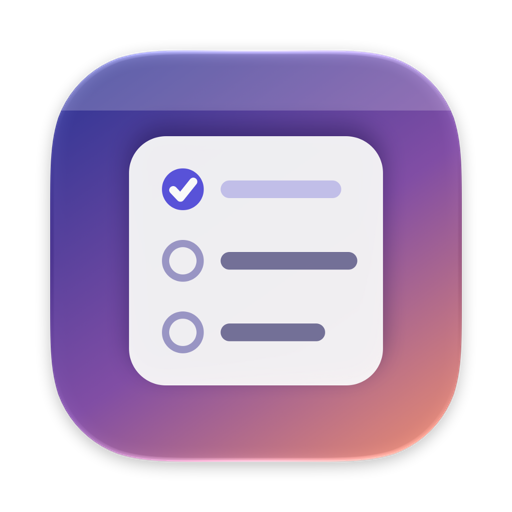
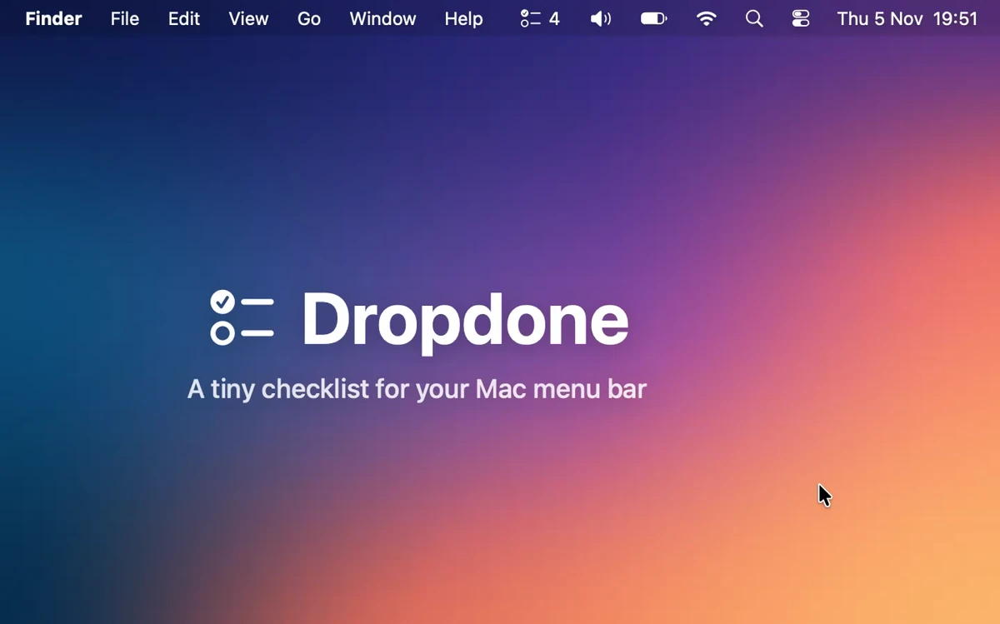
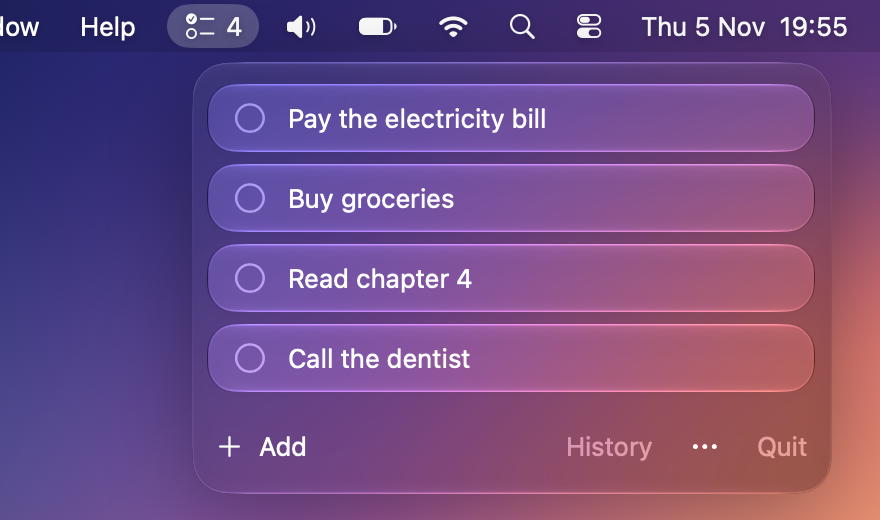
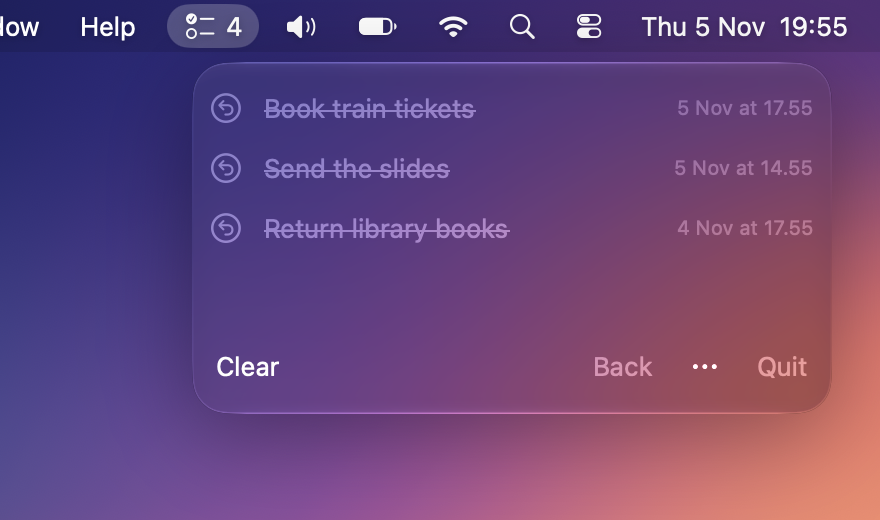

<p align="center">
  
</p>

<h1 align="center">Dropdone</h1>

<p align="center">
  A tiny checklist that lives in your Mac menu bar.<br>
  Click the icon, check things off, get back to work.
</p>

<p align="center">
  <a href="https://github.com/zuromu/dropdone/releases/latest"><b>Download</b></a>
  &nbsp;·&nbsp;
  <a href="#how-to-use-it">How to use it</a>
  &nbsp;·&nbsp;
  <a href="#build-it-yourself">Build it yourself</a>
</p>

<p align="center">
  <a href="https://github.com/zuromu/dropdone/actions/workflows/ci.yml"></a>
  <a href="LICENSE"></a>
  
</p>



## Why

Most todo apps want a whole window and a system for organizing your life. Sometimes you just need a short list of things for today that is always one click away. Dropdone sits next to Wi-Fi and Control Center, shows how many things are left, and gets out of the way. It uses Apple's Liquid Glass look so it fits right in with macOS Tahoe.

## Features

- **Always one click away.** The list drops down from the menu bar, and the number next to the icon shows what is left.
- **Undo built in.** A checked item stays for 5 seconds, so a wrong click is easy to fix.
- **History.** Finished items move to History with the time you finished them. Put any of them back with one click.
- **Quick to edit.** Press Command-N to add, double click to rename, drag to reorder, right click to delete.
- **One shortcut from anywhere.** Press Control-Option-D and the panel opens or closes, whatever app you are in.
- **Starts with your Mac** if you turn on Open at login.
- **Your data stays on your Mac** in a plain JSON file. No account, no sync, no tracking.

| Your list | History |
|---|---|
|  |  |

## How to use it

| You do | What happens |
|---|---|
| Click the menu bar icon | The panel opens. The number next to the icon is how many items are left |
| Press Control-Option-D | The panel opens or closes from any app, without going to the menu bar first |
| Click the circle on the left | Check or uncheck an item. A checked item fades, then moves to History after 5 seconds. Click the circle again before that to undo |
| Click **Add** or press Command-N | A new item appears, ready to type in |
| Double click an item | Edit its name, press Return to save |
| Drag an item | Move it up or down |
| Right click an item | Delete it |
| Click **History** | See your finished items, newest first |
| Click the arrow next to a finished item | Put it back on the list |
| Click **Clear** in History, then **Clear all?** | Delete all finished items for good. It asks twice so you cannot do it by accident |
| Click **Back** | Return to your list |
| Click the **...** button, then **Open at login** | Start Dropdone every time you log in. Turn it off the same way |

Saving an item with an empty name removes it. Your list is saved automatically in `~/Library/Application Support/Dropdone/items.json`.

## Install

1. Download the latest zip from the [Releases](https://github.com/zuromu/dropdone/releases/latest) page.
2. Unzip it and drag `Dropdone.app` into your Applications folder.
3. The app is not signed with an Apple Developer certificate yet, so the first time you open it, right click the app and choose **Open**.

Requires macOS 26 (Tahoe) or newer.

## Build it yourself

You need Xcode and [XcodeGen](https://github.com/yonaskolb/XcodeGen).

```bash
brew install xcodegen
git clone https://github.com/zuromu/dropdone.git
cd dropdone
xcodegen
open Dropdone.xcodeproj
```

Press Run in Xcode. To run the tests from the terminal:

```bash
xcodebuild test -scheme Dropdone -destination 'platform=macOS' CODE_SIGNING_ALLOWED=NO
```

## How the code is organized

```
Sources/Dropdone/
  DropdoneApp.swift     the app entry point, with no window of its own
  AppDelegate.swift     owns the menu bar item and the panel
  ContentView.swift     the panel with the list
  HistoryView.swift     the list of finished items
  ItemRow.swift         one row: checkbox, title, editing
  Item.swift            a single checklist item
  Store.swift           the list itself, plus saving and loading
  GlobalShortcut.swift  Control-Option-D, from any app
  LoginItem.swift       the open at login setting
  Assets.xcassets       the app icon
Tests/DropdoneTests/    unit tests for the store
project.yml             XcodeGen settings (the .xcodeproj is generated)
```

## Contributing

Bug reports and pull requests are welcome. Read [CONTRIBUTING.md](CONTRIBUTING.md) first.

## License

[MIT](LICENSE)
